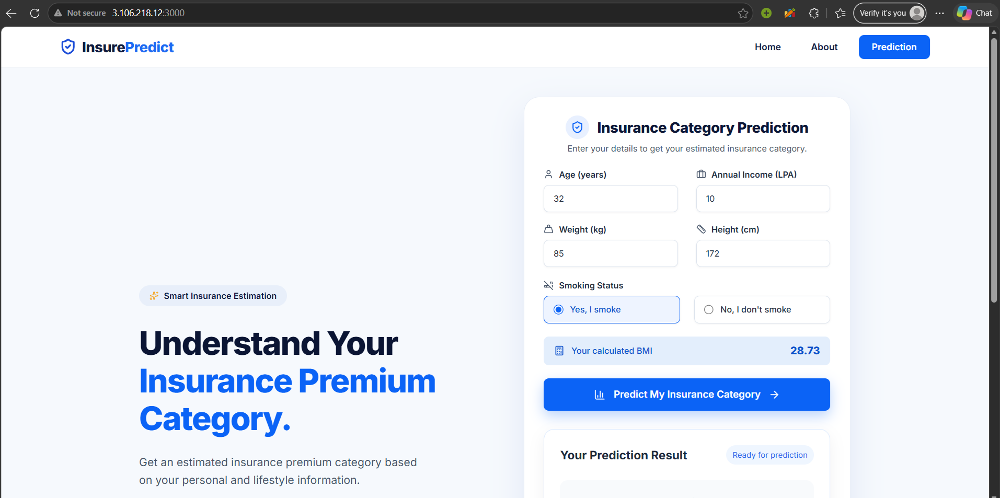
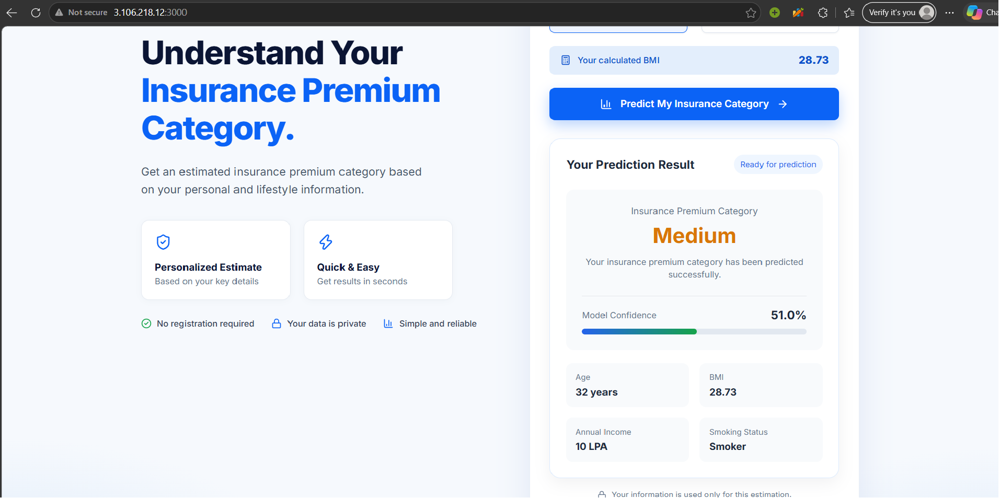

# Insurance Premium Prediction

A full-stack machine learning application that predicts health insurance premium categories (Low, Medium, or High) based on a user's age, BMI, smoking status, and annual income.

The application uses a Random Forest classifier to generate predictions and display confidence scores through an interactive web interface.

The frontend is built with React.js, while FastAPI handles backend requests. The application is containerized using Docker and deployed on AWS EC2 with Nginx as a reverse proxy.


## Live Demo

The application is deployed on AWS EC2 and can be accessed using the link below.

🌐 **Live Website:** [Insurance Premium Prediction](http://3.106.218.12:3000)

> **Note:** The website is available while the AWS EC2 instance is running. The public IP address may change if the instance is stopped and restarted.


## Features

- **Insurance Premium Prediction:** Predicts whether a user's insurance premium category is Low, Medium, or High.
- **Prediction Confidence:** Displays a confidence score for the predicted category.
- **Interactive User Interface:** Allows users to enter their details and view predictions.
- **Responsive Design:** Supports desktop and mobile screens.
- **REST API:** Uses FastAPI to process prediction requests.
- **Machine Learning Integration:** Uses a trained Random Forest classifier.
- **Docker Containerization:** Runs the frontend and backend in separate Docker containers.
- **Cloud Deployment:** Hosted on AWS EC2.
- **Nginx Reverse Proxy:** Handles frontend requests and forwards API requests to FastAPI.


## Tech Stack

| Component | Technology |
|-----------|------------|
| Frontend | React.js, Vite, JavaScript |
| Backend | Python, FastAPI |
| Machine Learning | Scikit-learn, Random Forest |
| Data Processing | Pandas, NumPy |
| Containerization | Docker, Docker Compose |
| Web Server | Nginx |
| Cloud Platform | AWS EC2 |
| Operating System | Ubuntu |
| Version Control | Git, GitHub |


## Project Architecture

The application follows a containerized frontend-backend architecture, with Nginx acting as a reverse proxy.

```text
User (Web Browser)
        |
        v
React Frontend (Port 3000)
        |
        v
Nginx Reverse Proxy
        |
        | /api/predict
        v
FastAPI Backend (Port 8000)
        |
        v
Random Forest ML Model
        |
        v
Prediction (Low / Medium / High)
        |
        v
React Frontend (Displays Result)
```

### How It Works

1. The user enters their age, BMI, smoking status, and annual income.
2. The React frontend sends a prediction request to `/api/predict`.
3. Nginx forwards the request to the FastAPI backend through Docker's internal network.
4. FastAPI validates the input and passes it to the trained Random Forest model.
5. The model predicts the insurance premium category and returns a confidence score.
6. The frontend displays the prediction to the user.

Both the frontend and backend run in separate Docker containers on AWS EC2, managed using Docker Compose.


## Project Structure

```text
Insurance-Premium-Prediction/
│
├── Backend/
│   └── FastApi/
│       ├── model/
│       │   ├── insurance_model.pkl
│       │   └── predict.py
│       ├── Schema/
│       │   └── User_input.py
│       ├── app.py
│       ├── requirements.txt
│       ├── Dockerfile
│       └── .dockerignore
│
├── Frontend/
│   ├── src/
│   │   ├── App.jsx
│   │   └── api.js
│   ├── public/
│   ├── nginx.conf
│   ├── Dockerfile
│   ├── package.json
│   └── .dockerignore
│
├── compose.yaml
└── README.md
```

> Note: The Python virtual environment, `node_modules`, and other generated files are excluded from this structure for clarity.


## Machine Learning Model

### Algorithm

**Random Forest Classifier**

The application uses a Random Forest classifier to predict insurance premium categories.

Random Forest combines multiple decision trees to make predictions. The trained model is saved as a `.pkl` file and loaded by the FastAPI backend for inference.

### Input Features

| Feature | Description |
|---------|-------------|
| Age | Age of the insurance applicant |
| BMI | Body Mass Index |
| Smoker | Whether the applicant smokes |
| Income (LPA) | Annual income in lakhs |

### Prediction Output

The model predicts one of three insurance premium categories:

- **Low**
- **Medium**
- **High**

The application also displays a confidence score for the predicted category.

### Model Evaluation

The model can be evaluated using the following classification metrics:

- **Accuracy:** Percentage of correctly classified samples.
- **Precision:** How often predictions for a category are correct.
- **Recall:** How many actual examples of a category are correctly identified.
- **F1-Score:** A combined measure of precision and recall.

> Actual evaluation scores will be added after verifying the results from the model's test dataset.

### Limitations

The model predicts premium categories rather than exact insurance costs. Predictions are estimates based on training data and should not be treated as official insurance quotations.


## Installation and Setup

### Prerequisites

Make sure the following tools are installed:

- Git
- Docker Desktop or Docker Engine
- Docker Compose

### 1. Clone the Repository

```bash
git clone https://github.com/YOUR_USERNAME/YOUR_REPOSITORY.git
cd YOUR_REPOSITORY
```

Replace the URL and folder name with your actual GitHub repository details.

### 2. Start the Application

Run the following command from the project's root directory:

```bash
docker compose up -d
```

Docker Compose will download the frontend and backend images from Docker Hub and start both containers.

### 3. Open the Website

Once the containers are running, open:

http://localhost:3000

Enter the required details and click **Predict** to get an insurance premium category.

### 4. Stop the Application

To stop and remove the running containers:

```bash
docker compose down
```

### Docker Hub Images

The application uses the following Docker images:

- `krshna12/insurance-premium-api:latest`
- `krshna12/insurance-premium-frontend:latest`


## Screenshots

### Home Page



### Prediction Result




## Future Improvements

- Add HTTPS and a custom domain for secure access.
- Implement CI/CD using GitHub Actions for automated testing and deployment.
- Add API monitoring and logging to track application performance.
- Implement automated unit and integration tests.
- Improve model performance through hyperparameter tuning.
- Add model monitoring to detect changes in prediction quality.
- Improve accessibility and mobile user experience.
